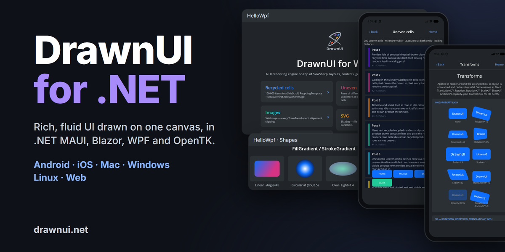

# DrawnUI for .NET




[](https://github.com/DrawnUi/DrawnUi.Net/blob/main/CONTRIBUTING.md)

Build rich, fluid UI by drawing it. Every control is painted on one hardware-accelerated canvas by DrawnUI, a
rendering engine on [SkiaSharp](https://github.com/mono/SkiaSharp) that works along your framework: .NET MAUI,
Blazor, WebAssembly, WPF and OpenTK. Compose it in C# code, XAML or Razor, the way you already work.

Docs: [drawnui.net](https://drawnui.net) · Playground: [drawfiddle.com](https://drawfiddle.com) · Blazor demo: [drawnui.net/sandbox](https://drawnui.net/sandbox/)

```csharp
Content = new Canvas
{
    RenderingMode = RenderingModeType.Accelerated,
    Gestures = GesturesMode.Enabled,
    Content = new SkiaStack
    {
        Spacing = 8,
        VerticalOptions = LayoutOptions.Center,
        Children =
        {
            new SkiaLabel("Hello World") { FontSize = 32, HorizontalOptions = LayoutOptions.Center },
            new SkiaButton("Tap me") { HorizontalOptions = LayoutOptions.Center }
                .OnTapped(me => me.Text = "Tapped!"),
        }
    }
};
```

## Packages

* `DrawnUi.Maui` - Android, iOS, Mac Catalyst and Windows.
* `DrawnUi.Blazor.Wasm` - Blazor WebAssembly in the browser.
* `DrawnUi.Blazor.Server` - drawn surfaces served by Blazor Server.
* `DrawnUi.Web` - pure WebAssembly in the browser, no Blazor needed.
* `DrawnUi.Wpf` - drawn controls inside WPF windows.
* `DrawnUi.OpenTk` - Windows and Linux desktops.
* `DrawnUi.Net` - rendering on any .NET host: console, server, tests.

## One family

DrawnUI for .NET is the same engine as [DrawnUI for React](https://github.com/DrawnUi/DrawnUi.React) (TypeScript on
CanvasKit in the browser) and [DrawnUI for Rust](https://github.com/DrawnUi/DrawnUi.Rust) (Windows, macOS, Linux,
iOS, Android and the web): the same controls, property names, layout and drawing rules. What you learn here works
there, and screens move between them.

## What you get, all drawn on one canvas

* **Layouts:** stacks, rows, grids, wrap and masonry, layers with any alignment.
* **Lists that stay smooth:** recycled cells over huge collections, items of different heights, load more at both ends.
* **Animations:** a frame loop for anything, Lottie and GIF, spritesheets, at the display's full frame rate.
* **Transforms in 2D and 3D:** rotate, scale, skew, perspective and depth; taps still land on the right control.
* **Gestures:** tap, long press, pan, pinch, swipe, drag to reorder, mouse hover, right-click menus.
* **Effects and shaders:** filters, shadows, blur and glass, SkSL shaders on any control, shader transitions.
* **Navigation:** shell with pages, popups, modals, toasts, carousel and drawer.
* **Text:** rich spans, markdown, right-to-left scripts, emoji and symbols, a drawn text editor.
* **Keyboard:** Tab, arrows, Enter and Escape move through every control, list, menu and dialog.
* **Accessibility:** screen readers read your drawn UI on every platform (Narrator, NVDA, VoiceOver, TalkBack, Orca, browser readers).
* **Fast:** caching, drawing only what is on screen, an idle canvas that uses no CPU.
* **Games:** a game loop and sprites.
* **AI-ready:** [skill files](https://drawnui.net/llms.txt) teach coding agents to build with it.

## MIT, everywhere

DrawnUI is MIT licensed in every language and on every platform: desktop, mobile, web and embedded devices. Ship it in commercial products with no attribution badge, no about screen and no per-device royalty.

Please star ⭐ if you like it!

## Addons

* Create games: `DrawnUi.Maui.Game`, `DrawnUi.Blazor.Game`, `DrawnUi.Web.Game`, `DrawnUi.OpenTk.Game`, `DrawnUi.Wpf.Game`.
* .NET MAUI only: `DrawnUi.MauiGraphics`
* .NET MAUI only: `DrawnUi.Maui.MapsUi`
* .NET MAUI only: `DrawnUi.Maui.Camera` - [Separate repo](https://github.com/taublast/DrawnUi.Maui.Camera).

---

## Resources

👉 [Docs and Samples](https://drawnui.net)   
🤖 [AI skills](https://drawnui.net/llms.txt)   
🤩 [Fiddle](https://drawfiddle.com)   
⛹️ [Pong in pure WASM](https://pong.appomobi.com/)

## What's New 1.10.8.24

  * **DrawnUI Designer on OpenTK.** Debug builds of OpenTK apps carry the Designer agent: the Designer attaches, shows screens and controls, edits them live and runs the app's Designer actions. `DrawnUiWindow.Current` and `DrawnUiWindow.Canvas` give tools the window and its canvas. Release builds don't include the agent.
  * **System light and dark.** `canvas.SystemTheme` and `SystemThemeChanged` report the system's light or dark appearance at start and on every change, on MAUI (every platform), WPF, OpenTK, Blazor and WebAssembly, as in DrawnUI for React and Rust.
  * **A steady frame tick on OpenTK.** `Super.OnFrame` fires every frame in OpenTK windows that redraw every frame, as on every other head, so code that waits for the next frame runs there too.

### Previously

  * **Tooltips and menus:** hover hints that stay by their control and wrap long text, icon buttons that show their accessibility name as a tooltip, right-click menus, dropdown lists and desktop menu bars, all usable from the keyboard; on Windows they can go past the app window's edge. On Mac, right click, two-finger click and Control-click open context menus, and two-finger trackpad scrolling glides on. A fresh default look with a blue accent and a slightly larger switch.
  * **Layout:** a `SkiaStack` without a set width (`HorizontalOptions` Center, Start or End) is as wide as its widest child, Fill children included, up to its `MaximumWidthRequest`, as in DrawnUI for React and Rust. Stacks of cards and labels lay out about twice as fast. `SkiaMasonry` (`LayoutType.Masonry`) lays items of different heights in columns without gaps, like a photo feed, with children or `ItemsSource`, recycled cells, `LoadMore`, `ScrollToIndex`, taps and keyboard arrows. See [Layouts](https://drawnui.net/articles/layouts.html). A control with a set width or height keeps exactly that size inside a row or a column, with its margins around it.
  * **Text:** Arabic, Hebrew and the other right-to-left scripts are shaped in every label, mixed directions read in the right order, a right-to-left paragraph starts at the right edge, and in `SkiaEditor` the caret, taps, selection and arrow keys follow the text on screen. Text is measured with exact widths, so a label wraps the same way on every platform and engine. The hook of a "j" and italic slants are drawn whole, emoji runs with `AutoFindFont` get their own room, and text after an italic span keeps normal spacing. Japanese and Chinese text wraps properly, symbols and emoji use `FontFamilyFallback`, people can select and copy a label's text (`AccessibilityTextSelectable`), and no text is cut at in-between screen scales. In `SkiaEditor`, the caret moves with each typed character in the same frame, an editor focused from code shows its caret at once, number keyboards type on Android and get a Done button on iOS, the iOS keyboard closes when you leave the page, and only one editor shows a caret when several are on screen. In a rich (markdown) label, a single character that only a fallback font has is drawn too. Text with an outline or a drop shadow keeps its letters together across styles and markdown runs.
  * **Lists:** templated lists of any length scroll smoothly with the wheel and the touchpad, in columns, grids (`Split`) and `SkiaWrap` grids, and a cell that changes size moves the cells below it. Recycled lists create new cells in the background while they scroll. A templated `SkiaRow` reports the items on screen in `FirstVisibleIndex` / `LastVisibleIndex`, a templated `SkiaWrap` fires `LoadMore` and reaches `ScrollToIndex`, a `SkiaScroll` with a `Header` places its `Footer` right after the content, and images keep loading after a page closes mid-fling. `ItemsSourceChangesApplied` comes after every change, and drag to reorder keeps every row drawn.
  * **Preview: DrawnUI Designer Agent.** Debug builds of your app carry the DrawnUI Designer agent: the Designer can attach to the running app, show its screens and controls, and edit them live. Apps can declare named states with `DesignerActions` (a level, a dialog) that the Designer jumps to, and the control tree updates as controls are added or removed (`Super.ChildrenChanged`). Release builds do not reference it. Pages built in code (`BasePageReloadable`) redraw on every hot reload, also under `dotnet watch`.
  * **Android:** hardware-accelerated canvases draw with Vulkan where available (about 11% less CPU per frame than OpenGL on a Mali-G57 phone) and fall back to OpenGL by themselves; `UseVulkan = false` keeps OpenGL. A Vulkan canvas can draw Android hardware buffers straight, for libraries such as the camera. The screen-reader bridge works with every `Xamarin.AndroidX.Core` version, and `DrawnUi.Maui` no longer brings the `AppoMobi.Maui.Native.Android` package.
  * **3D, glass and gradients:** `TranslationZ` moves a control toward you or away from you (closer is bigger), and with `RotationX` / `RotationY` it turns cards and panels in 3D with perspective. Cached content stays smooth under any rotated, scaled or skewed parent, and taps still reach the right control. A `SkiaBackdrop` in a transformed parent shows exactly what is behind it (set `UseCache = None` on a picture-cached `SkiaShape` around it for live glass). Gradient text and backgrounds show the same colors on every platform, and a round gradient fills the whole circle by default. An `ImageComposite` layer keeps drawing its content when a shader effect on it is removed.
  * **Platforms:** the game base (`DrawnGame`) also comes as `DrawnUi.Net.Game` for every .NET host, `Super.UseDrawnUi()` sets up fonts and styles the same way everywhere, and `OnToggled`, `WithLuminosity` and `WithPoints` work on every head, and OpenTK windows follow the window focus from the moment they open. On iOS and Mac Catalyst, pages and popups with a `Canvas` close cleanly ([#361](https://github.com/DrawnUi/DrawnUi.Net/issues/361)), a finger tap on iOS 26 is a plain tap, and native views inside a `SkiaMauiElement` complete their taps ([#374](https://github.com/DrawnUi/DrawnUi.Net/issues/374)). A `SkiaMauiElement` that starts hidden shows its native view when it becomes visible ([#372](https://github.com/DrawnUi/DrawnUi.Net/issues/372)).
  * **Scrolls, drawers, modals and carousels:** looped carousels move exactly one slide for a drag past the middle, also from the last slide to the first, shader carousels stay smooth when swiped fast across that wrap, and shader effects follow the content of scrolled pages. A scroll that started panning keeps the finger until it lifts, also outside its bounds. A `SkiaCarousel` swipe lands on the next or the previous slide, and a moving `SkiaShaderCarousel` takes a second swipe. Drawers keep the gestures of scrolls inside them and finish their moves, `SnapVelocityThreshold` sets how fast a flick is, `PopModalAsync` closes any modal in the stack, and the `ModalRemoved` event comes when a modal is fully gone.
  * **Faster and lighter:** a canvas tells its host when it needs a frame, so an idle screen uses no CPU at all, handy for putting DrawnUI inside another UI framework, and screens you leave free their memory right away. Animated shader effects keep the cache of the control under them, `UseCache = GPU` uses the GPU on every head, WebAssembly and OpenTK included, and drawing a frame creates far fewer objects (69.6 KB down to 12.9 KB per frame while scrolling uncached cards). GIFs and Lotties keep their speed while a list flings, `ImageDoubleBuffered` caches render in the background, a control updating behind another screen leaves the canvas idle, a canvas hidden in the view tree starts drawing again by itself when it shows, and iOS frames show on the very next refresh. Resizing a window keeps memory steady, WPF keeps the content on screen while you resize, and `ImageDoubleBuffered` controls appear the moment they are ready. A canvas, a WPF `DrawnUiElement` or a `SkiaShell` you drop without calling `Dispose` is freed together with everything it shows. A page you leave is freed with everything on it, even when it is not disposed, and a control you take off the screen pauses its animations and stops listening to keys until you put it back.
  * **Accessibility, mouse and keys:** Tab, Enter, Space, the arrow keys and Escape work the same in menus, lists and popups on every platform, and one key press does one thing; your app still gets every key and knows which ones the screen already used. Arrow keys can go round a menu or list, your code can move the focus, and on WPF a drawn menu bar works with Alt and the arrows. Menus and dropdown lists tell screen readers whether they are open or closed, and on WPF and OpenTK a long press is just a long press, never also a tap. TalkBack (Android), VoiceOver (iOS, Mac Catalyst), Orca (Linux) and browser screen readers read drawn controls, next to Narrator and Blazor, and Tab, a focus ring, Enter / Space and the arrow keys work on every head. Touchpad scrolling follows your fingers on MAUI Windows, WPF and OpenTK, Mac Catalyst mouse clicks arrive as mouse clicks, a right click or the Menu key reaches `SkiaControl.ContextMenu`, and `ReceivesHover` / `.OnHovered(...)` let any control take mouse hover. A drawn dialog marked with `AccessibilityModal` (Shell popups and modals do it by themselves) keeps screen readers, Tab, Enter and the arrow keys inside it and is announced by its name, also in the browser; the focus follows what's on screen, and Windows screen readers read radio groups as groups. A live region's new text (`AccessibilityLive`) reaches screen readers on the next frame, in the browser too. The tap ripple plays for a finger, a pen or the left mouse button, and a right click opens its menu without it. The Menu key and Shift+F10 open the menu of the control in keyboard focus on WPF, OpenTK, WebAssembly and MAUI Windows. A focused `SkiaEditor` hides its caret while another app has the keyboard and shows it again when you come back. On Blazor and WebAssembly the canvas focus follows the browser focus, so keys go on to the app when a focused control leaves the screen. Guide: [Accessibility](https://drawnui.net/articles/advanced/accessibility.html).
  * **Changed behavior:** a shader effect on a `SkiaShape` / `SkiaLabel` works on the control's own content (`UseCache = None` on the control for a see-through effect); `RespondsToGestures = false` switches input off on every interactive control (`SkiaButton.IsDisabled` is obsolete), and on .NET MAUI `IsEnabled = false` switches a drawn control and everything inside it off ([#368](https://github.com/DrawnUi/DrawnUi.Net/issues/368)); in a `SkiaWrap` a `Fill` child without `WidthRequest` takes a whole line; `SkiaStack` and `SkiaRow` honor `ZIndex`; `LockChildrenGestures` works on layouts; `TranslationZ` moves a control in depth (since 1.10.7.12; before, it only set the strength of the perspective); `SpeedRatio` means the real speed (0.5 is half); on Android with `UseDesktopKeyboard` text fields keep their keys; templated layouts default to `MeasureItemsStrategy="MeasureAll"` (set `MeasureFirst` for rows of one height).

---
MIT | Free to use and customize

---

DrawnUI is built and maintained by Nick Kovalsky, who is available for commercial work: full mobile and desktop app development, custom controls, performance and rendering work, Xamarin → MAUI migrations, and support contracts. Get in touch via [LinkedIn](https://www.linkedin.com/in/nick-kovalsky-92a770174/) or taublast(at)gmail.com.

