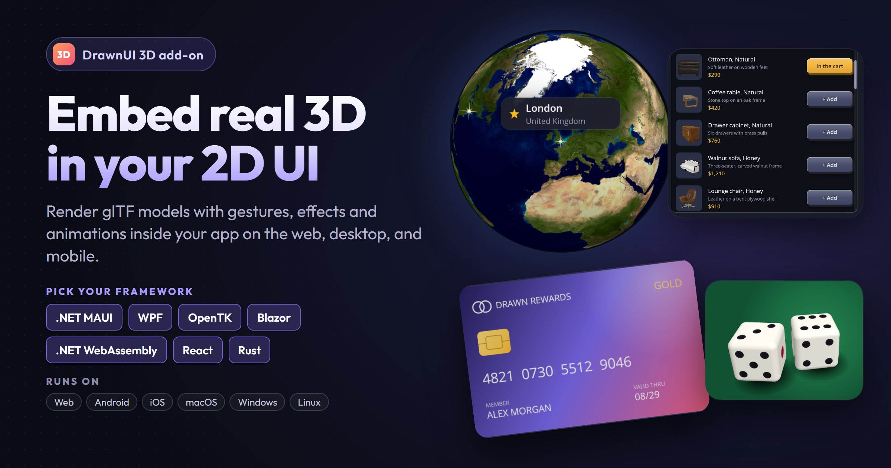
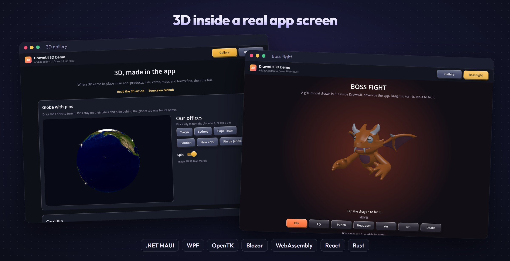
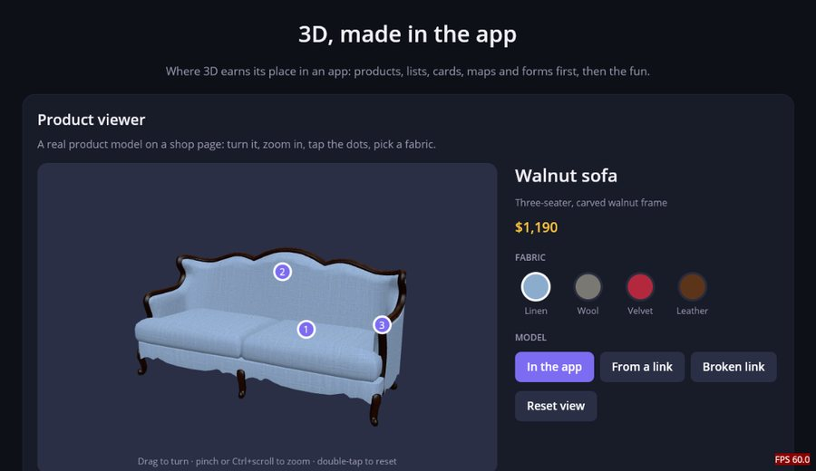

# 3D in DrawnUI

Real 3D models, live, inside your DrawnUI screens: they scroll with the page, take taps, and share the GPU your UI already uses. No WebView, no native 3D view, no game engine.

The 3D add-on runs everywhere DrawnUI runs: .NET MAUI (Android, iOS, Mac, Windows), WPF, OpenTK (Windows, Linux), Blazor, pure WebAssembly, React, and Rust (Windows, macOS, Linux, iOS, Android, web). It draws glTF models with their skeleton animations, shapes made in code and images on 3D surfaces, through the GPU context Skia already uses, so a 3D control lays out, scrolls, caches and takes gestures like any other control.

<a href="https://add3d.drawnui.net"></a>

## Try it now

One gallery, seven heads, same code shape. Open it in your browser:

<p>
<a class="btn btn-primary" href="https://add3dnet.drawnui.net">.NET · WebAssembly</a>
<a class="btn btn-primary" href="https://add3dblazor.drawnui.net">.NET · Blazor</a>
<a class="btn btn-primary" href="https://add3dreact.drawnui.net">React</a>
<a class="btn btn-primary" href="https://add3d.drawnui.net">Rust</a>
</p>

MAUI, WPF and OpenTK run the same gallery as apps: see [Samples](#samples).

## Hello 3D

A model with its animation, turning under the finger:

# [C#](#tab/csharp)

```csharp
using DrawnUi.Add3d;

new SkiaModel3D(dragonGlb)            // the .glb file's bytes
{
    Animation = "CharacterArmature|Flying_Idle",
    PinchZoom = true,
    HorizontalOptions = LayoutOptions.Fill,
    HeightRequest = 360,
}
```

# [React (TSX)](#tab/tsx)

```tsx
import { SkiaModel3D } from "drawnui-react-add3d";

<SkiaModel3D
  Glb={dragonGlb}                     // the .glb file's bytes
  Animation="CharacterArmature|Flying_Idle"
  PinchZoom={true}
  HorizontalOptions="Fill"
  HeightRequest={360}
/>
```

# [Rust](#tab/rust)

```rust
use drawnui_add3d::prelude::*;

SkiaModel3D::new(include_bytes!("assets/dragon.glb"))
    .animation("CharacterArmature|Flying_Idle")
    .pinch_zoom(true)
```

---

## Install

Add the package for your framework and head, then use the controls. There is no startup registration.

| Framework | Head | Package | Draws with |
|---|---|---|---|
| DrawnUI for .NET | .NET MAUI: Android, iOS, Mac Catalyst, Windows | `DrawnUi.Maui.Add3d` | Vulkan on Android, Metal on iOS and Mac, ANGLE on Windows |
| | WPF | `DrawnUi.Wpf.Add3d` | ANGLE |
| | OpenTK: Windows, Linux | `DrawnUi.OpenTk.Add3d` | OpenGL 3.3 or newer |
| | Blazor WebAssembly | `DrawnUi.Blazor.Add3d` | WebGL2 |
| | Pure WebAssembly | `DrawnUi.Web.Add3d` | WebGL2 |
| DrawnUI for Rust | Windows, Linux, macOS, iOS, Android, Web | crate `drawnui-add3d` | OpenGL, Metal, Vulkan, WebGL2 |
| DrawnUi.React | Web | npm `drawnui-react-add3d` | WebGL2 |

The controls, properties and methods have the same names in every framework, in each language's style:

| | C# | React (TSX) | Rust |
|---|---|---|---|
| Import | `using DrawnUi.Add3d;` | `import { SkiaModel3D, SkiaScene3D } from "drawnui-react-add3d";` | `use drawnui_add3d::prelude::*;` |
| Property | `PinchZoom = true` | `PinchZoom={true}` | `.pinch_zoom(true)` |
| Method | `PlayOnce("Wave")` | `PlayOnce("Wave")` | `play_once("Wave")` |
| Tap | `.OnTapped3D((me, hit) => ...)` | `Tapped3D={(me, hit) => ...}` | `.on_tapped_3d(\|me, app, cx, hit\| ...)` |

The text below uses the C# names; every example comes in all three languages.

On .NET desktop heads the canvas draws with `RenderingMode = RenderingModeType.Accelerated`: the 3D pass uses the canvas's GPU context.

## Samples

The 3D gallery is the same app in every framework:



| Framework | Runs on | Code | Try it |
|---|---|---|---|
| DrawnUI for .NET, pure WebAssembly (DrawnUi.Web) | browser | [Add3dGalleryWeb](https://github.com/DrawnUi/DrawnUi.Net/tree/main/src/Wasm/Samples/Add3dGalleryWeb) | [add3dnet.drawnui.net](https://add3dnet.drawnui.net) |
| DrawnUI for .NET, Blazor WebAssembly | browser | [Add3dGallery](https://github.com/DrawnUi/DrawnUi.Net/tree/main/src/Blazor/Samples/Add3dGallery) | [add3dblazor.drawnui.net](https://add3dblazor.drawnui.net) |
| DrawnUI for .NET, MAUI | Android, iOS, Mac, Windows | [Add3dGalleryMaui](https://github.com/DrawnUi/DrawnUi.Net/tree/main/src/Maui/Samples/Add3dGalleryMaui) | run the sample |
| DrawnUI for .NET, WPF | Windows | [Add3dGalleryWpf](https://github.com/DrawnUi/DrawnUi.Net/tree/main/src/Wpf/Samples/Add3dGalleryWpf) | run the sample |
| DrawnUI for .NET, OpenTK | Windows, Linux | [Add3dGalleryOpenTk](https://github.com/DrawnUi/DrawnUi.Net/tree/main/src/OpenTk/Samples/Add3dGalleryOpenTk) | run the sample |
| DrawnUI for Rust | Windows, macOS, Linux, iOS, Android, browser | [examples/gallery3d](https://github.com/DrawnUi/DrawnUi.Rust/tree/main/examples/gallery3d) | [add3d.drawnui.net](https://add3d.drawnui.net) |
| DrawnUi.React | browser | [samples/add3d](https://github.com/DrawnUi/DrawnUi.React/tree/master/samples/add3d) | [add3dreact.drawnui.net](https://add3dreact.drawnui.net) |

The five .NET versions share one gallery: [Add3dGallery.Shared](https://github.com/DrawnUi/DrawnUi.Net/tree/main/src/Shared/Samples/Add3dGallery.Shared).

## Why it is different

- **Normal control.** It takes part in layout, scrolling, caching, gestures and accessibility like any other DrawnUI control.
- **Same API everywhere.** Same names in C#, TSX and Rust, so code moves between frameworks.
- **Skia's own GPU.** It draws through the GPU context Skia already uses: Vulkan, Metal, ANGLE, OpenGL or WebGL2.
- **Pages keep scrolling.** Inside a scroll, an up and down drag scrolls the page and a sideways drag turns the model.
- **Free at rest.** A model that is still asks for no frames, models off screen cost nothing, and models near the screen are rendered ahead so they appear at once.

## Why not just SKMesh?

`SKMesh` draws triangles with your own SkSL shaders. It is the right tool for shader effects and custom 2D or 2.5D geometry. For 3D objects, everything beyond the triangles is yours to build:

| You need | With SKMesh | With the 3D add-on |
|---|---|---|
| Shapes and models | Generate triangles by hand, write your own glTF loader | `Mesh3D` shapes in code, glTF files with materials and textures |
| What is in front | No depth buffer on the 2D canvas: drop back faces and sort by hand | Real depth buffer on the GPU |
| Turning and perspective | Rotate and project every point yourself | `Yaw`, `Pitch`, zoom and framing built in |
| Look | Your own texture sampling and lighting shader | Lit, Toon and Flat looks, filtered textures, smooth edges |
| Animation | Your own skeleton system | glTF animations by name: loop, play once, blend, layers |
| Interaction | Your own drag, fling, pinch and hit math | Turn, fling, zoom, double tap reset, `Tapped3D` with the part hit |
| Labels on the model | Project and hide-test points yourself | `ScreenPosition` tells where a point is and whether it is hidden |
| Cost at rest | Redraws unless you stop it | Still model asks for no frames |

A globe with city pins is `Mesh3D.Sphere`, an Earth image and a few lines with the add-on. With `SKMesh` it is a small 3D engine to write and maintain.

Use `SKMesh` for effects. Use the 3D add-on for objects.

## Where it fits

- Product viewers: furniture, shoes, gadgets you turn with a finger, with fabric swatches and prices.
- Model that answers a tap, avatar beside a form, reward chest, globe with pins, card that flips.
- Games: 3D characters and elements inside a 2D game.

For a full 3D world with a free camera, physics and shadows, use a game engine. Vector illustrations and designer animations stay Lottie or SVG.

## Two controls

- **`SkiaModel3D`**: one model framed by its own camera.
- **`SkiaScene3D`**: one 3D layer over 2D content. Objects are placed in the layer's points like sprites, each with its own animation, and the whole layer draws in one pass.

## Showing a model

# [C#](#tab/csharp)

```csharp
using DrawnUi.Add3d;

new SkiaModel3D(avatarGlb)            // the .glb file's bytes
{
    Animation = "CharacterArmature|Idle",
    Yaw = 25, Pitch = 10,
    PinchZoom = true,
    ResetOnDoubleTap = true,
    HorizontalOptions = LayoutOptions.Fill,
    HeightRequest = 320,
}
.Assign(out _avatar)
.OnTapped3D((me, hit) => me.PlayOnce("CharacterArmature|Wave"));
```

# [React (TSX)](#tab/tsx)

```tsx
import { SkiaModel3D } from "drawnui-react-add3d";

<SkiaModel3D
  Glb={avatarGlb}                     // the .glb file's bytes, kept stable (a constant or useMemo)
  Animation="CharacterArmature|Idle"
  Yaw={25} Pitch={10}
  PinchZoom={true}
  ResetOnDoubleTap={true}
  HorizontalOptions="Fill"
  HeightRequest={320}
  Tapped3D={(me, hit) => me.PlayOnce("CharacterArmature|Wave")}
/>
```

# [Rust](#tab/rust)

```rust
use drawnui::prelude::*;
use drawnui_add3d::prelude::*;

SkiaModel3D::new(include_bytes!("assets/avatar.glb"))
    .animation("CharacterArmature|Idle")
    .view_angles(25.0, 10.0)
    .pinch_zoom(true)
    .reset_on_double_tap(true)
    .assign(&mut app.avatar)
    .on_tapped_3d(|me, _app: &mut App, _cx, _hit| {
        me.play_once("CharacterArmature|Wave");
    })
```

---

Names come from the file: `Animations`, `NodeNames` and `MaterialNames` list them. Look them up there, never guess them.

### Loading

- Pass the bytes of a glTF 2.0 binary (`.glb`), or set `Source` to a URL or an app file to load it in the background.
- `LoadState` tells `Loading`, `Ready` or `Failed` (`LoadStateChanged`, `Error`). Show your own message on `Failed`: the control stays empty.
- Controls showing the same model share one copy. What you set before it arrives (`Animation`, `IsPlaying`, `Speed`) applies once it is there.

### Animations

- `Animation` plays in a loop. `PlayOnce` plays and returns to the loop, `Hold` plays and stays on the last frame, `PlayLayer` / `StopLayer` play on top of the loop.
- `Speed`, `CrossfadeMs`, `IsPlaying`, and the `AnimationEnded` event after `PlayOnce` or `Hold`.

### Parts and materials

- Nodes by name: `SetNodeVisible`, `SetNodeTranslation`, `SetNodeRotation`, `SetNodeScale`, `ResetNode`.
- Materials by name: `SetMaterialColor`, `SetMaterialRoughness` (0 shiny, 1 matte), `SetMaterialVisible`, and `SetMaterialImage` with a `Texture3D` to put any image on a surface. `null` puts back what the file had.

### Taps

- `Tapped3D` tells the node, the material and the 3D point hit. A tap on empty space around the model is not a 3D tap.
- `ScreenPosition(point)` tells where a 3D point is on screen and whether the model hides it: pin labels to a model from `ViewChanged`.

### Turning and zooming

<a href="https://add3d.drawnui.net"></a>

The control behaves the same on every platform:

- Inside a scroll, a drag decides its direction at the start: up and down scrolls the page, sideways turns the model. Without a scroll around it, a drag turns it freely.
- A plain mouse wheel scrolls the page. Ctrl or Cmd + wheel, a touchpad pinch or a two-finger pinch zooms (`PinchZoom`, `MinZoom`, `MaxZoom`).
- A double tap resets the view (`ResetOnDoubleTap`), and `ResetView()` does it from code.
- `Fling = true`: a drag that is let go keeps the model turning, slowing down like a scroll after a swipe; a finger put down stops it.
- `LockPitch` keeps the horizon level, `Orbit = false` turns dragging off, `AutoRotate` turns the model slowly at rest, and `TiltToPointer` makes it lean toward the mouse or finger.

### Framing

The control fits its model tightly and never cuts it: it fits the model's real outline as it turns around the vertical axis, at the current pitch, with a little air around it, and keeps every animation of the file in frame.

- `FrameAnimations`: the animations kept in frame besides the model at rest; `null` (default) = every animation of the file. When the file has bigger animations the app never plays (a jump, a fall), name only the ones it plays, and the model shows larger.
- `FrameMargin`: room kept around the resting model, in model units (default 0), for parts that move past it (dice that tumble and hop, swinging arms). The view backs off so they stay in sight.

## Shapes made in code

Simple objects need no file: build a `Model3D` from parts.

# [C#](#tab/csharp)

```csharp
new SkiaModel3D(new Model3D()
    .Part("earth", Mesh3D.Sphere(1), Colors.White))
    .MaterialImage("earth", Texture3D.Decode(earthJpg));
```

# [React (TSX)](#tab/tsx)

```tsx
import { SkiaModel3D, Model3D, Mesh3D, Texture3D } from "drawnui-react-add3d";

// make the model once: a new Model value rebuilds the scene
const earth = useMemo(() => new Model3D().Part("earth", Mesh3D.Sphere(1), "#FFFFFF"), []);

<SkiaModel3D
  Model={earth}
  ref={(m) => { m?.SetMaterialImage("earth", Texture3D.Decode(earthJpg)); }}
/>
```

# [Rust](#tab/rust)

```rust
SkiaModel3D::from_model(&Model3D::new().part("earth", Mesh3D::sphere(1.0), Color::WHITE))
    .material_image("earth", Texture3D::decode(include_bytes!("assets/earth.jpg")).unwrap())
```

---

Meshes:

- `Sphere`, `Cylinder`, `Torus`, `Cuboid`.
- `RoundedCuboid(width, height, depth, radius, atlas = false)`: a centered box with rounded edges and corners (a die, a soap bar, a phone, a cushion); `radius` is at most half the smallest side. An image covers each face whole, upright on the sides, as on `Cuboid`. With `atlas: true` each face takes its own cell of one image split 3 x 2: +X, -X, +Y on the top row, -Y, +Z, -Z on the bottom, for example a die's six faces in one image.
- `Lathe` (a turned profile) and `Extrude` (any `SKPath` made 3D).

Each part is placed with `At`, `Turned`, `Scaled` and `Inside(parent)`. `Texture3D.FromImage` takes any Skia image: a photo, or a pattern drawn in code.

## 3D layer: SkiaScene3D

# [C#](#tab/csharp)

```csharp
new SkiaScene3D
{
    Tilt = 30,                        // how much of the objects' tops is seen
    HorizontalOptions = LayoutOptions.Fill,
    VerticalOptions = LayoutOptions.Fill,
}
.Model("character", characterGlb)
.Assign(out _layer)
.OnTapped3D((me, hit) => me.PlayOnce(hit.Object, "CharacterArmature|HitRecieve"));

// place and drive objects from code
_layer.Add("player", "character", x, y, 48);   // object name, model, position in points, height
_layer.SetPosition("player", x, y);
_layer.SetFacing("player", 90);
_layer.Play("player", "CharacterArmature|Walk");
```

# [React (TSX)](#tab/tsx)

```tsx
import { SkiaScene3D, type SkiaScene3DCtrl } from "drawnui-react-add3d";

const layer = useRef<SkiaScene3DCtrl>(null);

<SkiaScene3D
  ref={layer}
  Tilt={30}                           // how much of the objects' tops is seen
  HorizontalOptions="Fill"
  VerticalOptions="Fill"
  Tapped3D={(me, hit) => me.PlayOnce(hit.Object, "CharacterArmature|HitRecieve")}
/>

useEffect(() => {
  const l = layer.current!;
  l.Model("character", characterGlb);
  l.Add("player", "character", x, y, 48);      // object name, model, position in points, height
  l.Play("player", "CharacterArmature|Walk");
}, []);

// from your game code (nothing re-renders)
layer.current!.SetPosition("player", x, y);
layer.current!.SetFacing("player", 90);
```

# [Rust](#tab/rust)

```rust
SkiaScene3D::new()
    .model("character", include_bytes!("assets/character.glb"))
    .tilt(30.0)                       // how much of the objects' tops is seen
    .fill()
    .assign(&mut app.layer)
    .on_tapped_3d(|me, _app: &mut App, _cx, hit| {
        me.play_once(&hit.object, "CharacterArmature|HitRecieve");
    })

// place and drive objects from code
if let Some(mut layer) = cx.get_mut(app.layer) {
    layer.add("player", "character", x, y, 48.0); // object name, model, position in points, height
    layer.set_position("player", x, y);
    layer.set_facing("player", 90.0);
    layer.play("player", "CharacterArmature|Walk");
}
```

---

- `Model(name, ...)` registers a model once; `Add` places an object that uses it, `Remove` and `ClearObjects` take objects away.
- `SetPosition`, `SetFacing`, `SetSize` and `SetVisible` move and change an object; moving it never re-measures the layout.
- `Play`, `PlayOnce`, `Hold`, `SetSpeed` and `AnimationEnded` work per object, `SetMaterialColor` and `SetMaterialImage` per object and material.
- `Tapped3D` tells which object, node and material was hit.

## Looks

| `Look` | What it gives |
|---|---|
| `Look.Lit` (default) | shaded by a key light, a soft fill and the sky |
| `Look.Toon` | two tones, lit and shade, like a cartoon |
| `Look.Flat` | each color as it is: an illustration |

`OutlineWidth` and `OutlineColor` draw an ink line around every shape; Toon or Flat with an outline gives a drawn look. Looks switch live: models, positions and animations stay. `Antialias = true` smooths edges per control; it costs GPU time, so keep it for large controls.

## Performance

- A model that is still (no animation, no drag, no auto-rotate) asks for no frames. A layer off screen stops its animations.
- A model near the screen is rendered ahead while the frame has time left, so it shows at once when it scrolls in.
- Cache the cards around a resting model as usual. Do not cache a control that changes every frame, such as an animated model.
- Size the control to the design: the cost grows with its pixels.
- In web apps, embed only the models of the first screen and load the rest from URLs.
- The 3D GPU memory of a window is freed when the window closes.

## Tips

- Tell people how to use a viewer, under it: "Drag to turn · pinch or Ctrl+scroll to zoom · double-tap to reset".
- Use production-quality glTF models (realistic or well-made stylized), keep each file small (textures at the size they show, unused animations removed), and keep a license file next to them.
