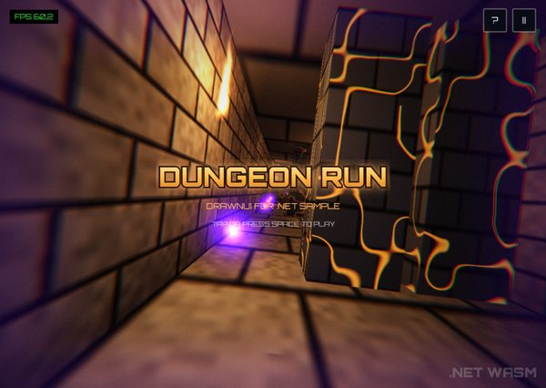
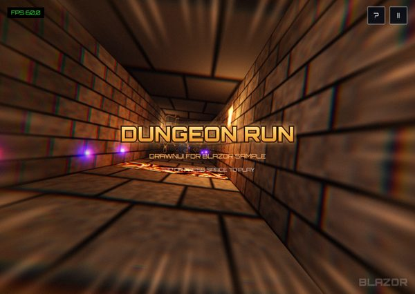
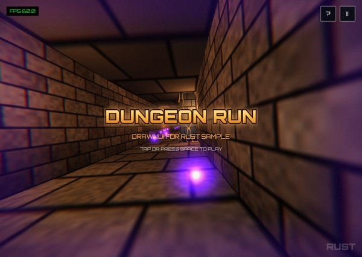
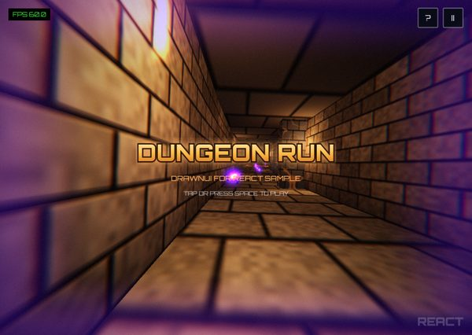
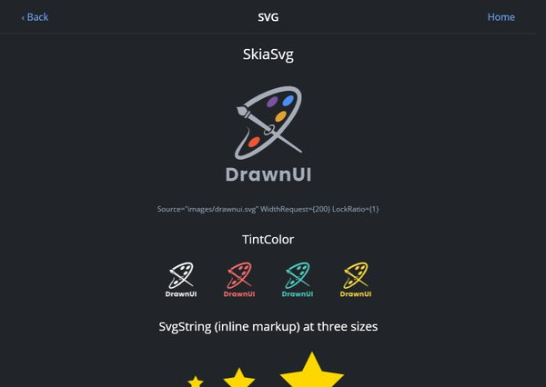

# Sample Apps

Explore real-world applications and demo projects built with DrawnUI to see the framework in action.

## 🌍 Same Apps Everywhere

DrawnUI draws every pixel of the UI itself, so an app looks and behaves the same wherever it runs. Two showcase apps are built screen for screen in **DrawnUI for .NET**, **DrawnUI for Rust** and **DrawnUi.React**, with the same controls and the same property names.

### Dungeon Run

_A 3D dungeon runner: one SKMesh corridor, SkSL shaders, a HUD and drawn dialogs. The same game in every engine._

| Framework | Heads | Play it live | Source |
|---|---|---|---|
| DrawnUI for .NET | Web (pure WebAssembly), Blazor WebAssembly, .NET MAUI (Android, iOS, Mac Catalyst, Windows), WPF, OpenTK (Windows, Linux) | [dungeonnet.drawnui.net](https://dungeonnet.drawnui.net), [dungeonblazor.drawnui.net](https://dungeonblazor.drawnui.net) | [DrawnUi.Dungeon.Net](https://github.com/DrawnUi/DrawnUi.Dungeon.Net) |
| DrawnUI for Rust | Web (WebAssembly), Windows, Linux, macOS, Android, iOS | [run.drawnui.net](https://run.drawnui.net) | [examples/dungeon](https://github.com/DrawnUi/DrawnUi.Rust/tree/main/examples/dungeon), [examples/dungeon-android](https://github.com/DrawnUi/DrawnUi.Rust/tree/main/examples/dungeon-android) |
| DrawnUi.React | Web | [dungeonreact.drawnui.net](https://dungeonreact.drawnui.net) | [samples/dungeon](https://github.com/DrawnUi/DrawnUi.React/tree/master/samples/dungeon) |

The same start screen in four browser tabs: .NET WebAssembly, Blazor, Rust and React.

<div style="display:flex; flex-wrap:wrap; gap:8px;">
  <a href="https://dungeonnet.drawnui.net"></a>
  <a href="https://dungeonblazor.drawnui.net"></a>
  <a href="https://run.drawnui.net"></a>
  <a href="https://dungeonreact.drawnui.net"></a>
</div>

### Hello App

_The same 20-screen catalog in every framework: layouts, text, images, shapes, shaders, gestures, shell, editor, accessibility, Pong and more._

| Framework | Heads | Try it | Source |
|---|---|---|---|
| DrawnUI for .NET | .NET MAUI (Android, iOS, Mac Catalyst, Windows), WPF, OpenTK (Windows, Linux) | run the sample on desktop or a phone | [HelloMaui](https://github.com/DrawnUi/DrawnUi.Net/tree/main/src/Maui/Samples/HelloMaui), [HelloWpf](https://github.com/DrawnUi/DrawnUi.Net/tree/main/src/Wpf/Samples/HelloWpf), [HelloOpenTk](https://github.com/DrawnUi/DrawnUi.Net/tree/main/src/OpenTk/Samples/HelloOpenTk) |
| DrawnUI for Rust | Web (WebAssembly), Windows, Linux, macOS, Android, iOS | [hellorust.drawnui.net](https://hellorust.drawnui.net) | [examples/hellorust](https://github.com/DrawnUi/DrawnUi.Rust/tree/main/examples/hellorust), [examples/hellorust-android](https://github.com/DrawnUi/DrawnUi.Rust/tree/main/examples/hellorust-android) |
| DrawnUi.React | Web | [helloreact.drawnui.net](https://helloreact.drawnui.net) | [samples/demo](https://github.com/DrawnUi/DrawnUi.React/tree/master/samples/demo) |

.NET in the browser has its own showcase, the [Blazor Sandbox](https://drawnui.net/sandbox/) (see below).

The SVG screen on React and on Rust, side by side:

<div style="display:flex; flex-wrap:wrap; gap:8px;">
  <a href="https://helloreact.drawnui.net/#/svg"></a>
  <a href="https://hellorust.drawnui.net/#/svg"></a>
</div>

And the code of its "TintColor" row, the same four tinted logos in each framework:

# [C#](#tab/csharp)

```csharp
new SkiaWrap
{
    Spacing = 24,
    HorizontalOptions = LayoutOptions.Center,
    Children = new List<SkiaControl>
    {
        Tinted(Colors.White),
        Tinted(Color.Parse("#FF6B6B")),
        Tinted(Color.Parse("#4ECDC4")),
        Tinted(Color.Parse("#FFD93D")),
    },
},

static SkiaSvg Tinted(Color tint) => new()
{
    Source = "images/drawnui.svg",
    WidthRequest = 72,
    LockRatio = 1,
    TintColor = tint,
};
```

# [React (TSX)](#tab/tsx)

```tsx
<SkiaRow Spacing={24} HorizontalOptions="Center">
  <SkiaSvg Source="images/drawnui.svg" WidthRequest={72} LockRatio={1} TintColor={Colors.White} />
  <SkiaSvg Source="images/drawnui.svg" WidthRequest={72} LockRatio={1} TintColor="#FF6B6B" />
  <SkiaSvg Source="images/drawnui.svg" WidthRequest={72} LockRatio={1} TintColor="#4ECDC4" />
  <SkiaSvg Source="images/drawnui.svg" WidthRequest={72} LockRatio={1} TintColor="#FFD93D" />
</SkiaRow>
```

# [Rust](#tab/rust)

```rust
SkiaWrap::new().spacing(24).horizontal_options(LayoutOptions::Center).children(
    [Color::WHITE, hex(0xFF6B6B), hex(0x4ECDC4), hex(0xFFD93D)]
        .map(|tint| SkiaSvg::new(LOGO).width_request(72).lock_ratio(1).tint_color(tint))
        .into_iter()
        .collect::<Vec<_>>(),
)
```

---

## 🎮 Learning Projects

- **[Blazor Sandbox](https://github.com/DrawnUi/DrawnUi.Net/tree/main/src/Blazor/Samples/BlazorSandbox)** 🌐 - Explore the browser-hosted DrawnUI sample surface with:
  - Blazor `Canvas` hosting patterns
  - Control and layout probes
  - Tutorial ports for browser runtime
  - Current Blazor validation pages

  [See it live in browser!](https://drawnui.net/sandbox/)


- **[Pong (DrawnUi.Web)](https://github.com/DrawnUi/DrawnUi.Net/tree/main/src/Wasm/Samples/PongWeb)** 🕹️ - A full game running as **pure WebAssembly** (no Blazor) with:
  - `DrawnUi.Web` standalone host (`RunAsync`)
  - GPU (WebGL) rendering with raster fallback
  - HTTP-loaded fonts, `GesturesMode.Lock` with iOS swipe guard
  - OG/Twitter SEO metadata

  [Play it live!](https://pong.appomobi.com/)

  A minimal starter app also lives at **[tpls/Wasm/EmptyCode](https://github.com/DrawnUi/DrawnUi.Net/tree/main/tpls/Wasm/EmptyCode)**.


- **[HelloMaui](https://github.com/DrawnUi/DrawnUi.Net/tree/main/src/Maui/Samples/HelloMaui)** 📱 - The full feature demo on .NET MAUI (Windows, Android, iOS, MacCatalyst), one page per feature navigated with a drawn `SkiaShell`: recycled cells, images, SVG, shapes, text, layouts, platform looks, carousels, Lottie, shell, editor, keyboard, scroll, shaders, sprites, transforms, drag to reorder, accessibility. Same pages as HelloWpf and the [React](react/index.md) and [Rust](rust/index.md) demos.

- **[MauiPong](https://github.com/DrawnUi/DrawnUi.Net/tree/main/src/Maui/Samples/MauiPong)** 🕹️ - The Pong game on .NET MAUI: a thin host (window, fonts, background, `RescalingCanvas`) over the shared `src/Shared/Samples/Pong.Shared` game, built with the `DrawnUi.Maui.Game` addon. Tap to serve, arrow keys move the paddle on desktop. The same game runs on OpenTK, WPF, Blazor and pure WebAssembly.

- **[MAUI Demo](https://github.com/taublast/AppoMobi.Maui.DrawnUi.Demo)** 🤩 - A comprehensive totally drawn app demo featuring:
  - Navigation on the canvas with SkiaShell
  - Recycled cells and virtualization
  - Camera integration examples
  - Custom controls showcase

- **[MAUI Sandbox](https://github.com/DrawnUi/DrawnUi.Net/tree/main/src/Maui/Samples/Sandbox)** 🧪 - Experiment with:
  - Playground examples
  - Custom controls development
  - Maps integration
  - Various styling approaches

- **[Shaders Carousel](https://github.com/taublast/ShadersCarousel/)** ✨ - Advanced SkiaSharp shaders capabilities
  - Custom SKSL shader effects
  - Visual effects showcase
  - Hardware acceleration examples
  - Modern rendering techniques

## ⭐️ Published Apps

Published open-source apps:

### Bricks Breaker
_Arkanoid/Breakout-style arcade game_
- **Browse Code**: [Github repository](https://github.com/DrawnUi/DrawnUi.Net.Breakout)
- **Play on Web**: [Bricks Breaker Web](https://taublast.github.io/DrawnUi.Breakout)
- **Install**: [AppStore](https://apps.apple.com/us/app/bricks-breaker/id6749823869?platform=iphone), [Google Play](https://play.google.com/store/apps/details?id=com.appomobi.drawnui.breakout)
- **Architecture**: Single Canvas root with drawn dialogs
- **Features**: DrawnUI game helpers and mecanics

### Filters Camera
_Camera with real-time filters totally drawn on canvas_
- **Browse Code**: [Github repository](https://github.com/taublast/ShadersCamera)
- **Install**: [AppStore](https://apps.apple.com/us/app/filters-camera/id6749823005?platform=iphone), [Google Play](https://play.google.com/store/apps/details?id=com.appomobi.drawnui.shaderscam)
- **Architecture**: Single Canvas root, MAUI popups for settings.
- **Features**: SKSL shaders and `SkiaCamera` control

### SolTempo
_Real-time pitch detection, BPM/tempo detection_
- **Browse Code**: [Github repository](https://github.com/taublast/SolTempo)
- **Install**: [AppStore](https://apps.apple.com/app/soltempo/id6759321593), [Google Play](https://play.google.com/store/apps/details?id=com.appomobi.soltempo)
- **Read More**: [Blog article](https://taublast.github.io/posts/SolTempo/)
- **Architecture**: App drawn on a single DrawnUI `Canvas`
- **Features**: Real-time pitch detection, BPM/tempo detection, SKSL Shaders effects and confetti! 

- **Snippets**: more DrawnUI snippets you can run and edit right in the browser at [drawfiddle.com](https://drawfiddle.com).

## Contributing Samples
Have a cool UI or feature? Submit a PR or open an issue to share your sample with the community!
